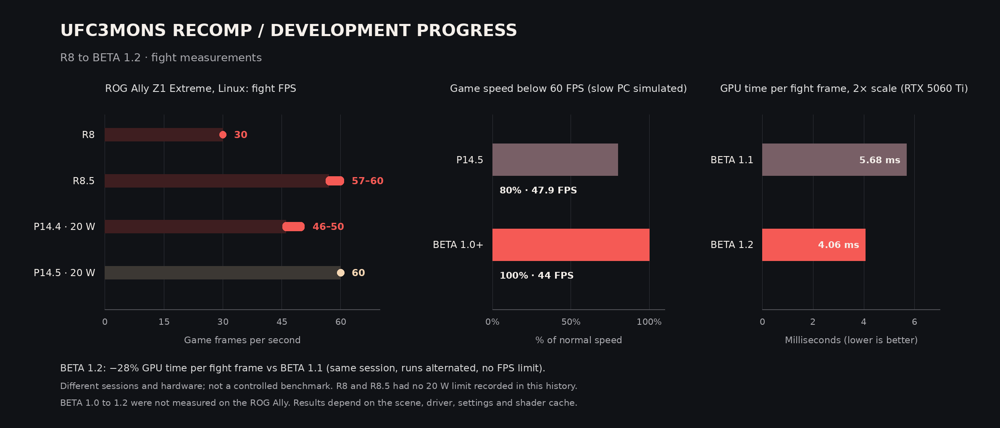

# UFC UNDISPUTED 3 - UFC3MONS RECOMP

[English](README.md) · [Português (Brasil)](README.pt-BR.md) · **Español**

### Proyecto nativo experimental para PC con Windows y Linux

> 🎯 **Enfoque principal: el mod Reborn.** UFC3MONS se hace primero para el mod comunitario **UFC Undisputed Reborn**. Reborn
> recibe más pruebas y más correcciones; el juego Original también es compatible. El mérito de Reborn pertenece a sus creadores.

**UFC3MONS** es un proyecto experimental y no oficial para ejecutar UFC Undisputed 3 de forma nativa en PC, con Windows y Linux.
Usa recompilación estática con ReXGlue, un backend gráfico Vulkan y componentes de compatibilidad derivados de Xenia.

El proyecto reúne un launcher de configuración, soporte de mando y teclado, integración con el juego y mejoras de CPU/GPU. Las
configuraciones del Original y de Reborn se siguen por separado.

> La **versión 1.9** corrige el cierre de Reborn en peleas de peso mosca seguidas, hace que las peleas de UFC usen camisetas de UFC
> y las de PRIDE camisetas de PRIDE, devuelve los acentos a los menús en portugués de Reborn, corrige la rueda de arenas de PRIDE,
> añade el área Información del sistema con verificación automática del procesador y llega en builds PGO. [Lee las notas de la 1.9](docs/GITHUB-RELEASE-1.9.md).
> Los archivos del juego original no están incluidos: necesitas tu propia copia del juego.

> **Las actualizaciones públicas están en pausa.** La próxima versión pública será la 1.13, cuando esté terminada, validada y
> aprobada, sin plazo definido. El desarrollo continúa de forma interna con un renderizador Vulkan nativo.

[Ver el código](https://github.com/monscriser/UFC3MONS/tree/main/app) · [Releases](https://github.com/monscriser/UFC3MONS/releases) · [Sitio del proyecto](https://monscriser.github.io/UFC3MONS/) · [Reportar un problema](https://github.com/monscriser/UFC3MONS/issues)

## UFC Undisputed 3 en PC: resumen

| Función | Estado / detalles |
| --- | --- |
| Windows | Carrera y Exhibición de Reborn jugables; probado en PC (NVIDIA) y ROG Ally Z1 Extreme |
| Linux | Pelea de Carrera de Reborn fija a 60 FPS en ROG Ally Z1 Extreme a 20 W (Modo Juego de Steam) |
| Gráficos | Vulkan mediante el backend derivado de ReXGlue/Xenia; escalado AMD FSR 1 opcional |
| Audio | Narración completa, incluidos los anuncios de Bruce Buffer |
| Controles | Mando y teclado reasignable |
| Ediciones | Carpeta de Reborn, Original (XEX o carpeta) o ISO, leída directamente sin extraer |
| DLC | Se instala desde una carpeta en el launcher; los luchadores de DLC aparecen en su propia página de selección |
| Launcher | Portugués (Brasil), inglés y español; Añadir a Steam con artes; Información del sistema |
| Trucos | Recompensas máximas de entrenamiento (modo Auto), recompensa máxima de técnicas (Auto, experimental) y Dinero doble (Carrera). Todos desactivados por defecto |
| Contenido del juego | Necesario por separado; no se distribuye aquí |

## Novedades

```
P7    ── caché de constant buffers · Carrera reportada fluida en el Ally
P10   ── lotes de protección de memoria · reutilización de descriptores · limpieza del launcher
P11   ── camisetas para los 342 modelos de Reborn
P12   ── camisetas variadas (fijas por modelo)
P13   ── corrección de memoria en la entrada de los luchadores · temporizador de 1 ms en el Original
P14   ── nuevo launcher (PT/EN/ES) · Bruce Buffer corregido · AMD FSR 1 · envío a la GPU en dos hilos · trucos
BETA 1.0 ── sin cámara lenta entre 60 y 30 FPS · direct resolve · pestaña Mods · precompilación opcional de shaders · filtrado de texturas
BETA 1.1 ── carga directa de texturas · opción de VSync · corrección del overlay de RenderDoc en Linux
BETA 1.2 ── −28% de GPU por cuadro · sangre corregida a 2× o más · bucle de audio corregido · camiseta/gorra del luchador creado en el Original
BETA 1.3 ── Original: las copias escaladas ya no se leen de vuelta (3×: ~30 → 59 FPS) · sin caída de FPS en peleas largas
BETA 1.4 ── Linux, Original: fin de las congelaciones de varios segundos en los cambios de escena
BETA 1.5 ── menos CPU por draw (todo exacto, 0 diferencias) · corrección de cierre de Reborn (tabla de saltos)
BETA 1.6 ── readback de GPU más seguro para luchadores creados · recompensa Auto experimental para técnicas de la Carrera
BETA 1.7 ── entradas e introducciones a 60 FPS a velocidad original · luchador creado en la selección en ~1,5 s · pestaña CAF de Reborn
BETA 1.8 ── luchadores creados sin negro/estática en AMD · presentación a 60 FPS reales · cierre de la Exhibición peso mosca de Reborn · PGO
1.9      ── peleas de peso mosca seguidas · título de peso mosca en la tarjeta · camisetas por organización · acentos y títulos de Reborn en PT-BR · rueda de arenas de PRIDE · Información del sistema
```

P8 y P9 fueron builds de investigación. Los registros detallados, con mediciones, están en las [Releases](https://github.com/monscriser/UFC3MONS/releases).

## Rendimiento

### BETA 1.2 — tiempo de GPU por cuadro de pelea (GPU de escritorio, escala 2×, sin límite de FPS)

```
BETA 1.1   5.68 ms  ████████████████████████████
BETA 1.2   4.06 ms  ████████████████████          −28 %
```

RTX 5060 Ti, la misma pelea repetida, ejecuciones alternadas en una sesión. Cada cambio tiene un parámetro para activarlo o
desactivarlo en las pruebas: consulta los [parámetros de la BETA 1.2](docs/PARAMETERS-BETA-1.2.md).

### ROG Ally Z1 Extreme, Linux, 20 W — pelea de Carrera de Reborn

| Métrica (misma pelea, Ally a 20 W) | P14.4 | P14.5 |
|---|---:|---:|
| FPS medio | 46–50 | **60** |
| Coste de un fallo de página del write-watch | ~330 µs | **~59 µs** |
| Tiempo en fallos de página | ~280 ms por segundo | **61 ms por segundo** |
| Reloj de la GPU | oscilando entre 800 y 2000 MHz | **~1790 MHz, estable** |

En Linux, cada fallo de página del write-watch leía y analizaba el archivo `/proc/self/maps` completo; la comprobación lenta ahora
solo se ejecuta cuando hace falta. El rendimiento depende de la escena, el hardware, el driver, la configuración y el estado de la
caché de shaders. La recompilación estática por sí sola no garantiza más rendimiento que un emulador. La versión 1.9 no añade
nuevas optimizaciones de rendimiento.



*Mediciones de sesiones y hardware diferentes, no un benchmark controlado.*

## Funciones

### Launcher
- Pestañas: **Inicio, Ajustes, Mods, Trucos, Correcciones, Registros, Partidas, Novedades**.
- Origen del juego: **carpeta de Reborn, XEX/carpeta del Original o ISO** (la ISO se lee directamente).
- Instalación de DLC desde una carpeta; **Añadir a Steam** crea un acceso directo con artes.
- Teclado reasignable; soporte de mando.
- **Información del sistema** (Ajustes): procesador, soporte AVX2 y modo de ejecución, solo lectura. El procesador se verifica antes de abrir el juego.
- Copia de seguridad de partidas, limpieza de la caché de shaders y carpetas de registros a un clic. **Guardar registros** está desactivado por defecto.

### Gráficos, tiempo y rendimiento
- Renderizado Vulkan con modificaciones del SDK propias del proyecto; escalado **AMD FSR 1** opcional (desactivado por defecto).
- Envío a la GPU en dos hilos, cachés de constantes/descriptores, lotes de registros y de protección de memoria.
- Render targets pequeños a tamaño nativo: la sangre y las marcas se quedan en su sitio a 2× o más.
- Ruta rápida de fallos de página en Linux; control de readback en Linux que sigue siendo barato en sesiones largas (1.9).
- Shaders síncronos y límite de 60 FPS. Contador de FPS en el juego con **F6**. Panel para salir: **F4** o Back + Start durante 3 s.

### Trucos (desactivados por defecto, funcionan con el juego abierto)
- **Recompensas máximas de entrenamiento (modo Auto):** el entrenamiento AUTO de la Carrera da la mejor nota del entrenamiento manual (4 estrellas).
- **Dinero doble:** los Creds ganados en cada pelea de la Carrera cuentan el doble, dentro del máximo del propio juego.
- **Recompensa máxima al aprender/mejorar técnicas (Auto, experimental):** busca la nota más alta en las sesiones Auto de técnicas;
  la persistencia tras aceptar el resultado aún necesita confirmación en el juego.

### Reborn
- Camisetas para los **342** modelos de luchadores; las peleas de UFC usan camisetas de UFC o neutras y las de PRIDE, camisetas de PRIDE o neutras (1.9).
- Acentos restaurados en los menús en portugués (1.9).
- Título de peso mosca en la tarjeta previa a la pelea; títulos de categoría en portugués en la tarjeta y el marcador cuando el juego está en portugués (1.9).
- Los archivos originales del juego nunca se modifican; se crean copias compatibles en el primer inicio.

## Compatibilidad con el Original y Reborn

| Configuración | Estado actual del desarrollo |
| --- | --- |
| Reborn | Carrera y Exhibición jugables en Windows y Linux; peleas de peso mosca seguidas probadas en PC (1.9) |
| Original | Jugable desde XEX/carpeta o ISO. Los luchadores creados (CAF) guardan correctamente piel, camiseta y gorra |
| Ambos | DLC compatible. Se agradecen más pruebas de jugabilidad, partidas, controles y hardware |

## Primeros pasos

### Para jugadores
1. Descarga el zip de Windows o el AppImage de Linux en las [Releases](https://github.com/monscriser/UFC3MONS/releases).
   - El zip de Windows contiene `Launcher-Config.exe`, `UFC3.exe` y `data/`. Cada archivo tiene un `.sha256` para comprobarlo.
2. Abre el launcher y apúntalo a **tu propia** copia del juego: carpeta de Reborn, XEX/carpeta del Original o ISO.
3. Opcional: instala DLC desde una carpeta, elige resolución/FSR 1 e idioma, o usa **Añadir a Steam**.
4. Pulsa **JUGAR**.

**Requisitos:** tarjeta gráfica con Vulkan y procesador x86-64 con SSSE3 y SSE4.1 (SSE4.2 en Reborn para Windows). **AVX2 no es
necesario.** Si al procesador le falta alguna instrucción necesaria, el launcher lo avisa antes de abrir el juego.

El botón **Download ZIP** de GitHub descarga el código fuente, no un juego jugable. No se incluyen datos del juego, DLC ni partidas.

### Para desarrolladores
1. Lee [dependencias y limitaciones de compilación](docs/DEPENDENCIAS.md).
2. Usa `app/common/` para el código actual del launcher y de la integración. Consulta `app/variants/` para las instantáneas históricas.
3. Revisa `sdk-modified/` y los cambios incrementales en `patches/`.
4. Trata `scripts/historical/` como registros del entorno original, no como comandos de compilación portables.

Una compilación limpia aún requiere un SDK compatible, código generado a partir de tu propia copia del juego y otras dependencias locales.

## Estructura del repositorio

| Ruta | Contenido |
| --- | --- |
| `app/common/` | Código compartido de la integración y del launcher |
| `app/variants/` | Archivos de integración por plataforma y edición |
| `app/fixes/` | Correcciones de entrada/presentación y muestreadores de diagnóstico opcionales |
| `sdk-modified/` | Modificaciones de GPU/runtime, headers de apoyo y el shader de readback |
| `patches/` | Cambios incrementales respecto a instantáneas locales anteriores |
| `scripts/` | Scripts de parche, compilación, empaquetado y medición (rutas locales) |
| `docs/` | Estado del desarrollo, dependencias, notas de versión e información de publicación |
| `LICENSES/` | Licencia de terceros incluida |
| `index.html` | Página independiente del proyecto para GitHub Pages |

## Limitaciones conocidas

- Por debajo de 30 FPS la acción todavía se ralentiza (entre 60 y 30 FPS la velocidad es normal desde la BETA 1.0).
- Las mayúsculas acentuadas de la fuente de los menús de Reborn quedan un poco más bajas que las demás.
- Algunos menús, vídeos (Bink) y pantallas de carga van a 30 FPS o caen por momentos.
- No se midieron los FPS en pelea en el Steam Deck en la 1.9.
- Los overlays externos pueden mostrar la tasa de cuadros del compositor; F6 muestra el contador del propio juego.
- Las recetas históricas reutilizan objetos locales y headers precompilados. Las compilaciones portables y reproducibles siguen pendientes.
- El código generado del juego y `ufc_offline_memory.h` se excluyen a propósito del código fuente.

## Reportar problemas y contribuir

Abre un [issue](https://github.com/monscriser/UFC3MONS/issues) con la versión (por ejemplo, 1.9), la edición Original/Reborn, el
sistema operativo, CPU, GPU, driver, escena, modo de juego, pasos para reproducir, ajustes de pantalla y los registros relevantes.
Para obtener registros, activa **Guardar registros** en **Registros**, juega y usa **Abrir todos los registros**. Las capturas
ayudan si no tienen información personal.

No subas archivos del juego, DLC, código generado del juego ni partidas personales a issues públicos.

## Créditos y licencias

Gracias a los desarrolladores y colaboradores de **ReXGlue**, **Xenia**, **Dear ImGui**, **RenderDoc**, **AMD FidelityFX
(FSR 1)** y a las comunidades de gráficos y recompilación. El trabajo previo de rendimiento de HydroThunderPORT inspiró
optimizaciones adaptadas para este proyecto.

Algunas correcciones de la BETA 1.7 partieron de ideas encontradas en [UFC3ReX](https://github.com/360recomper/UFC3ReX), de
360recomper: el bloqueo de la vista previa 3D del luchador creado, el locutor esperando Start, el guardado de las respuestas del
primer inicio, el cierre al cargar Liddell vs Quarry en PRIDE y la opción de iluminación estable de la piel. Estudiamos cómo
explicaron cada problema y escribimos nuestra propia implementación; no se incluye código de UFC3ReX en este repositorio.

El código propio usa la licencia [MIT](LICENSE). Los archivos derivados de ReXGlue/Xenia conservan la licencia BSD; el header de
RenderDoc conserva su aviso MIT. Consulta los [avisos de terceros](THIRD_PARTY_NOTICES.md) y [LICENSES](LICENSES/).

UFC3MONS es un proyecto comunitario no oficial, sin vínculo ni respaldo de los desarrolladores, editores o titulares de las marcas
del juego original. Los nombres, artes y contenidos de UFC Undisputed 3 pertenecen a sus respectivos titulares. Este repositorio
no concede ninguna licencia sobre esos materiales.
