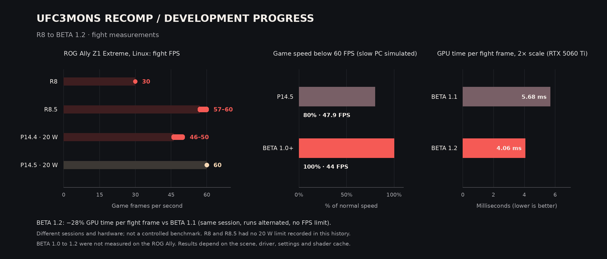

# UFC UNDISPUTED 3 - UFC3MONS RECOMP

**English** · [Português (Brasil)](README.pt-BR.md) · [Español](README.es.md)

### Experimental native PC project for Windows & Linux

> 🎯 **Main focus: the Reborn mod.** UFC3MONS is built first for the community-created **UFC Undisputed Reborn** mod. Reborn gets
> the most testing and the most fixes; the Original game is supported too. Credit for Reborn belongs to its creators.

**UFC3MONS** is an experimental, unofficial native PC project for UFC Undisputed 3 on Windows and Linux. It uses static
recompilation with ReXGlue, a Vulkan graphics backend and Xenia-derived compatibility components.

The project combines a configuration launcher, controller and keyboard support, game integration and CPU/GPU improvements.
Original and Reborn configurations are tracked separately.

> **Version 1.9** fixes the Reborn flyweight crash when fights are played back to back, gives UFC fights UFC shirts and PRIDE
> fights PRIDE shirts, restores the accents in Reborn's Portuguese menus, fixes the PRIDE arena wheel, adds a System information
> area with automatic CPU checks and ships as PGO builds. [Read the 1.9 notes](docs/GITHUB-RELEASE-1.9.md).
> Original game files are not included: you need your own copy of the game.

> **Public updates are paused.** The next public release will be 1.13, once it is complete, validated and approved, with no ETA.
> Development continues internally on a native Vulkan renderer.

[Explore the source](https://github.com/monscriser/UFC3MONS/tree/main/app) · [Releases](https://github.com/monscriser/UFC3MONS/releases) · [Project website](https://monscriser.github.io/UFC3MONS/) · [Report an issue](https://github.com/monscriser/UFC3MONS/issues)

## UFC Undisputed 3 on PC: Quick Overview

| Feature | Status / details |
| --- | --- |
| Windows | Reborn Career and Exhibition playable; tested on PC (NVIDIA) and ROG Ally Z1 Extreme |
| Linux | Reborn Career fight at a locked 60 FPS on ROG Ally Z1 Extreme at 20 W (Steam Game Mode) |
| Graphics | Vulkan through the ReXGlue/Xenia-derived backend; optional AMD FSR 1 upscaling |
| Audio | Full commentary, including Bruce Buffer's ring announcements |
| Input | Controller and remappable keyboard |
| Editions | Reborn folder, Original (XEX or folder) or ISO, read directly without extracting |
| DLC | Installed from a folder in the launcher; DLC fighters appear on their own select page |
| Launcher | Portuguese (Brazil), English and Spanish; Add to Steam with artwork; System information |
| Cheats | Full Training Rewards (Auto Mode), experimental Maximum Technique Reward (Auto), and Double Money (Career). All are off by default |
| Game content | Required separately; not distributed here |

## What's new

```
P7    ── constant-buffer cache · Career reported smooth on the Ally
P10   ── memory-protection batching · descriptor reuse · launcher cleanup
P11   ── shirts for all 342 Reborn models
P12   ── varied shirts (fixed per model)
P13   ── fighter entrance memory fix · 1 ms timer for Original
P14   ── new launcher (PT/EN/ES) · Bruce Buffer fixed · AMD FSR 1 · two-thread GPU submission · cheats
BETA 1.0 ── no slow motion from 60 to 30 FPS · direct resolve · Mods tab · optional shader pre-compile · texture filtering
BETA 1.1 ── direct texture loading · VSync option · RenderDoc overlay fix on Linux
BETA 1.2 ── −28% GPU per frame · blood fix at 2× and above · audio loop fix · Original created-fighter shirt/hat fixed
BETA 1.3 ── Original: scaled copies no longer read back (3×: ~30 → 59 FPS) · no FPS decline during long fights
BETA 1.4 ── Linux, Original: no more multi-second freezes on scene changes
BETA 1.5 ── less CPU per draw (all exact, 0 differences) · Reborn crash fix (jump table)
BETA 1.6 ── safer GPU readback for created fighters · experimental Auto reward for Career techniques
BETA 1.7 ── 60 FPS walkouts and intros at original speed · created fighter on select in ~1.5 s · Reborn CAF tab
BETA 1.8 ── no black/static created fighters on AMD · true 60 FPS pre-fight presentation · Reborn flyweight Exhibition crash fix · PGO
1.9      ── back-to-back flyweight fights · flyweight card title · shirts by organization · PT-BR accents and titles in Reborn · PRIDE arena wheel · System information
```

P8 and P9 were investigation builds. Detailed changelogs with measurements are in the [Releases](https://github.com/monscriser/UFC3MONS/releases).

## Performance

### BETA 1.2 — GPU time per fight frame (desktop GPU, 2× scale, no FPS limit)

```
BETA 1.1   5.68 ms  ████████████████████████████
BETA 1.2   4.06 ms  ████████████████████          −28 %
```

RTX 5060 Ti, same fight replayed, runs alternated in one session. Every change has a parameter to switch it on or off for tests:
see [BETA 1.2 parameters](docs/PARAMETERS-BETA-1.2.md).

### ROG Ally Z1 Extreme, Linux, 20 W — Reborn Career fight

| Metric (same fight, Ally @ 20 W) | P14.4 | P14.5 |
|---|---:|---:|
| Average FPS | 46–50 | **60** |
| Cost of one write-watch page fault | ~330 µs | **~59 µs** |
| Time spent in page faults | ~280 ms per second | **61 ms per second** |
| GPU clock | swinging 800–2000 MHz | **~1790 MHz, stable** |

On Linux, every write-watch page fault used to read and parse the whole `/proc/self/maps` file; the slow check now runs only when
needed. Performance depends on the scene, hardware, driver, settings and shader-cache state. Static recompilation alone does not
guarantee higher performance than an emulator. Version 1.9 does not add new performance optimizations.



*Measurements from different sessions and hardware, not a controlled benchmark.*

## Features

### Launcher
- Tabs: **Home, Settings, Mods, Cheats, Fixes, Logs, Saves, What's new**.
- Game source: **Reborn folder, Original XEX/folder or ISO** (the ISO is read directly).
- DLC install from a folder; **Add to Steam** creates a shortcut with artwork.
- Remappable keyboard; controller support.
- **System information** (Settings): processor, AVX2 support and execution mode, read only. The CPU is checked before the game starts.
- Save backup, shader-cache cleanup and log folders one click away. **Write logs** is off by default.

### Graphics, Timing and Performance
- Vulkan rendering with project-specific SDK modifications; optional **AMD FSR 1** upscaling (off by default).
- Two-thread GPU submission, constant/descriptor caches, register and memory-protection batching.
- Native-size small render targets: blood and decals stay in place at 2× and above.
- Linux page-fault fast path; Linux readback tracking that stays cheap in long sessions (1.9).
- Synchronous shaders and a 60 FPS limit. In-game FPS overlay toggled with **F6**. Quit panel: **F4** or Back + Start for 3 s.

### Cheats (off by default, work while the game is running)
- **Full Training Rewards (Auto Mode):** AUTO training in Career gives the best Manual Training grade (4 stars).
- **Double Money:** Creds earned from each Career fight count twice, within the game's own maximum.
- **Maximum reward for learning/improving techniques (Auto, experimental):** targets the highest grade for Auto technique sessions;
  persistence after accepting the result still needs gameplay confirmation.

### Reborn
- Shirts for all **342** fighter models; UFC fights use UFC or neutral shirts and PRIDE fights PRIDE or neutral shirts (1.9).
- Accents restored in the Portuguese menus (1.9).
- Flyweight title on the pre-fight card; category titles in Portuguese on the card and scoreboard when the game is in Portuguese (1.9).
- Original game files are never modified; compatible copies are created on first start.

## Original and Reborn Compatibility

| Configuration | Current development status |
| --- | --- |
| Reborn | Career and Exhibition playable on Windows and Linux; flyweight fights back to back tested on PC (1.9) |
| Original | Playable from XEX/folder or ISO. Created fighters (CAF) save their baked skin, shirt and hat correctly |
| Both | DLC supported. Wider gameplay, save, controller and hardware testing is still welcome |

## Getting Started

### For Players
1. Download the Windows zip or the Linux AppImage from [Releases](https://github.com/monscriser/UFC3MONS/releases).
   - The Windows zip contains `Launcher-Config.exe`, `UFC3.exe` and `data/`. Each file has a `.sha256` to check it.
2. Open the launcher and point it to **your own** game: Reborn folder, Original XEX/folder or ISO.
3. Optional: install DLC from a folder, pick resolution/FSR 1 and language, or use **Add to Steam**.
4. Press **PLAY**.

**Requirements:** a Vulkan GPU and an x86-64 CPU with SSSE3 and SSE4.1 (SSE4.2 for Reborn on Windows). **AVX2 is not required.**
If the processor lacks a required instruction set, the launcher says so before the game starts.

GitHub's **Download ZIP** button downloads source code, not a playable game. No game data, DLC or saves are included.

### For Developers
1. Read [dependencies and build limitations](docs/DEPENDENCIAS.md).
2. Use `app/common/` for the current launcher and integration sources. Refer to `app/variants/` for historical snapshots.
3. Review `sdk-modified/` and the incremental changes in `patches/`.
4. Treat `scripts/historical/` as records of the original environment, not portable build commands.

A clean build still requires a compatible SDK, code generated from your own game copy and other local dependencies.

## Repository Layout

| Path | Contents |
| --- | --- |
| `app/common/` | Shared integration and launcher sources |
| `app/variants/` | Platform- and edition-specific integration files |
| `app/fixes/` | Input/presentation fixes and optional diagnostic samplers |
| `sdk-modified/` | GPU/runtime modifications, support headers and the readback shader |
| `patches/` | Incremental changes against previous local snapshots |
| `scripts/` | Patch, build, packaging and measurement scripts (local paths) |
| `docs/` | Development state, dependencies, release notes and publication information |
| `LICENSES/` | Included third-party license |
| `index.html` | Standalone project page for GitHub Pages |

## Known Limitations

- Below 30 FPS the action still slows down (between 60 and 30 FPS the speed stays normal since BETA 1.0).
- Accented uppercase letters in Reborn's menu font are slightly shorter than the others.
- Some menus, videos (Bink) and loading screens run at 30 FPS or drop briefly.
- Steam Deck in-fight FPS was not measured for 1.9.
- External overlays may report the compositor's frame rate; F6 reports the game's own frame counter.
- Historical recipes reuse local objects and precompiled headers. Portable, reproducible builds are pending.
- Generated game code and `ufc_offline_memory.h` are deliberately excluded from the sources.

## Reporting Issues and Contributing

Open an [issue](https://github.com/monscriser/UFC3MONS/issues) and include the version (for example 1.9), Original/Reborn edition,
operating system, CPU, GPU, driver, scene, game mode, reproduction steps, display settings and relevant logs. To get logs, turn on
**Write logs** in **Logs**, play, then use **Open all logs**. Screenshots are useful when private information is removed.

Do not upload game files, DLC, generated game code or personal saves to public issues.

## Credits and Licensing

Thanks to the developers and contributors behind **ReXGlue**, **Xenia**, **Dear ImGui**, **RenderDoc**, **AMD FidelityFX
(FSR 1)** and the graphics and recompilation communities. Earlier HydroThunderPORT performance work informed optimizations
adapted for this project.

Some BETA 1.7 fixes started from ideas found in [UFC3ReX](https://github.com/360recomper/UFC3ReX) by 360recomper: the
created fighter 3D preview freeze, the announcer waiting for Start, saving the first-start answers, the PRIDE Liddell vs
Quarry load crash and the steady skin lighting option. We studied how they explained each problem and wrote our own
implementation; no UFC3ReX code is included in this repository.

Own code uses [MIT](LICENSE). ReXGlue/Xenia-derived files retain BSD licensing; the RenderDoc header retains its MIT notice.
See [third-party notices](THIRD_PARTY_NOTICES.md) and [LICENSES](LICENSES/).

UFC3MONS is an unofficial community project, not affiliated with or endorsed by the original game's developers, publishers
or trademark owners. UFC Undisputed 3 names, artwork and content belong to their respective rights holders. This repository
grants no license to those materials.
