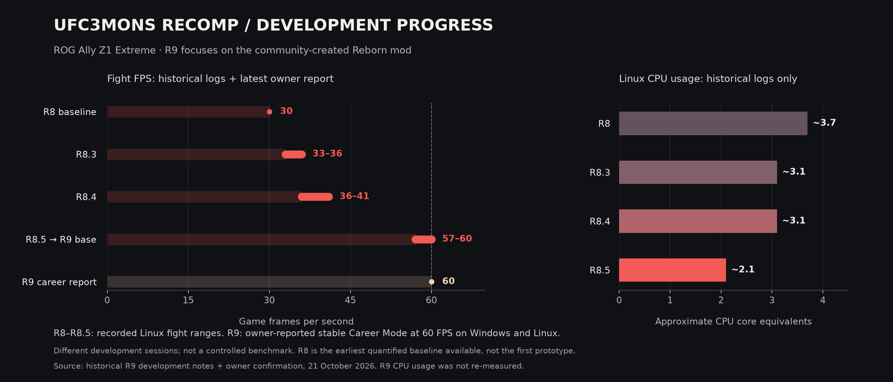

# UFC UNDISPUTED 3 - UFC3MONS RECOMP

### Experimental native PC project for Windows & Linux

**UFC3MONS** is an experimental, unofficial UFC Undisputed 3 native PC project for Windows and Linux, using static recompilation with ReXGlue, a Vulkan graphics backend and Xenia-derived compatibility components.

The project combines a configuration launcher, controller support, game integration and CPU/GPU improvements. Original and Reborn configurations are tracked separately. **R9 primarily focuses on the community-created Reborn mod**, featured in community YouTube videos; credit for the mod belongs to its creators.

> **Current development candidate: R9.** This repository publishes integration sources and SDK modifications, not a ready-to-play game. Original game files and recompiled game code are not included. A complete, portable build process is still pending.

[Explore the source](https://github.com/monscriser/UFC3MONS/tree/main/app) · [Project website](https://monscriser.github.io/UFC3MONS/) · [Report an issue](https://github.com/monscriser/UFC3MONS/issues)

## UFC Undisputed 3 on PC: Quick Overview

| Feature | Status / details |
| --- | --- |
| Windows | Reborn Career Mode owner-tested on ROG Ally Z1 Extreme at 60 FPS |
| Linux | Reborn Career Mode owner-tested on ROG Ally Z1 Extreme at 60 FPS |
| Graphics | Vulkan through the ReXGlue/Xenia-derived backend |
| Input | Controller support; R9 serializes concurrent input calls |
| Editions | Separate Original and Reborn configurations |
| ROG Ally | Latest R9 Reborn Career report: stable 60 FPS on Windows and Linux |
| Public sources | Launcher, integration code, SDK changes and historical scripts |
| Game content | Required separately; not distributed here |

## Development Highlights — R9

- **Controller stability:** input serialization addresses the vibration-related crash identified in earlier builds.
- **Frame reporting:** ties overlay presentation to guest frames, correcting repeated UI redraws that inflated external FPS counters.
- **CPU/GPU work:** register and constant optimizations, a shared-memory shortcut and a second GPU submission thread.
- **Linux audio waiting:** preserves sub-millisecond precision, addressing a busy loop that consumed a CPU core.
- **ROG Ally:** earlier R8.5 Linux fight logs reported 57–60 FPS, compared with approximately 30 FPS before the changes. This is a specific development test, not a guarantee for other hardware or every scene.

R9 combines those changes without the optional profiling samplers. The maintainer now reports stable R9 Reborn Career Mode on Windows and Linux on ROG Ally Z1 Extreme, at 60 FPS, without observed gameplay bugs or texture errors in those sessions. This is not a guarantee for every scenario. See the [development notes](docs/LEIA-ME-R9-historico.md).

## Reborn Career Mode on ROG Ally Z1 Extreme

The maintainer reports stable **60 FPS on both Windows and Linux**, with no gameplay bugs or texture errors observed in the tested Career sessions. This build keeps the engine timing at its current 60 FPS target/limit. Read the [full R9 release notes](docs/RELEASE-R9.md).

Historical R8–R8.5 values are Linux development-session observations. R9 is a separate owner report, not a controlled benchmark; R8 is the earliest quantified baseline available.

## Features

### Game Integration and Launcher

- Configuration launcher and game-directory handling.
- Separate code variants for Windows/Linux and Original/Reborn.
- Integration for locally supplied game content.
- In-game FPS overlay toggled with **F6**.
- Diagnostic helpers for testing and investigating compatibility issues.

### Graphics, Timing and Performance

- Vulkan rendering with project-specific SDK modifications.
- Guest-frame presentation and GPU submission improvements.
- Reduced CPU overhead in selected register, constant and memory operations.
- Synchronous shader mode for the current candidate.
- Console vsync stays enabled: disabling it accelerated game logic in earlier testing.

Performance depends on the scene, hardware, driver, settings and shader-cache state. Static recompilation alone does not guarantee higher performance than an emulator.

## Original and Reborn Compatibility

| Configuration | Current development status |
| --- | --- |
| Original | Career Mode graphics bugs, including an invisible opponent, remain under investigation; fixes are planned for future builds |
| Reborn | Career Mode owner-tested as stable at 60 FPS on Windows/Linux, without observed gameplay bugs or texture errors in the tested sessions |
| Both | Wider gameplay, save, controller and hardware testing is still needed |

## Getting Started

### For Players

This source repository does not currently provide a complete installation route. Windows ZIP and Linux AppImage references in development notes describe local test artifacts, not a public download offer.

GitHub's **Download ZIP** button downloads source code, not a playable game. The public source set excludes game data, generated game code and the local offline patch payload.

### For Developers

1. Read [dependencies and build limitations](docs/DEPENDENCIAS.md).
2. Inspect `app/variants/` for the platform and edition you are studying; these files take precedence over shared snapshots.
3. Review `sdk-modified/` and the incremental changes in `patches/`.
4. Treat `scripts/historical/` as records of the original environment, not portable build commands.

A clean build still requires a compatible SDK, code generated from your own game copy and other local dependencies. These published sources alone cannot reproduce the R9 executables.

## Repository Layout

| Path | Contents |
| --- | --- |
| `app/common/` | Shared integration and launcher snapshots |
| `app/variants/` | Platform- and edition-specific integration files |
| `app/fixes/` | Input/presentation fixes and optional diagnostic samplers |
| `sdk-modified/` | GPU/runtime modifications, support headers and the readback shader |
| `patches/` | Incremental R9 changes against previous local snapshots |
| `scripts/historical/` | Original build and packaging recipes with local dependencies |
| `docs/` | Development state, dependencies and publication information |
| `LICENSES/` | Included third-party license |
| `index.html` | Standalone project page for GitHub Pages |

## Known Limitations

- Latest gameplay confirmation covers Reborn Career Mode on the maintainer’s ROG Ally Z1 Extreme; broader hardware and scenario coverage is still needed.
- The Original configuration can render an invisible opponent; this remains unresolved.
- Loading and scene changes can cause temporary frame-rate drops.
- External overlays can report the compositor's frame rate; F6 reports the project's game-frame counter.
- Historical recipes reuse local objects and precompiled headers. Portable, reproducible builds are pending.
- Generated game code and `ufc_offline_memory.h` are deliberately excluded.

## Reporting Issues and Contributing

Open an [issue](https://github.com/monscriser/UFC3MONS/issues) and include candidate revision, Original/Reborn edition, operating system, CPU, GPU, driver, scene, game mode, reproduction steps, display settings and relevant logs. Screenshots are useful when private information is removed.

For comparison tests, use the same scene and settings. Do not upload game files, DLC, generated game code or personal saves to public issues.

## Credits and Licensing

Thanks to the developers and contributors behind **ReXGlue**, **Xenia**, **Dear ImGui**, **RenderDoc** and the graphics and recompilation communities. Earlier HydroThunderPORT performance work informed optimizations adapted for this project.

Own code uses [MIT](LICENSE). ReXGlue/Xenia-derived files retain BSD licensing; the RenderDoc header retains its MIT notice. See [third-party notices](THIRD_PARTY_NOTICES.md) and [LICENSES](LICENSES/).

UFC3MONS is an unofficial community project, not affiliated with or endorsed by the original game's developers, publishers or trademark owners. UFC Undisputed 3 names, artwork and content belong to their respective rights holders. This repository grants no license to those materials.
