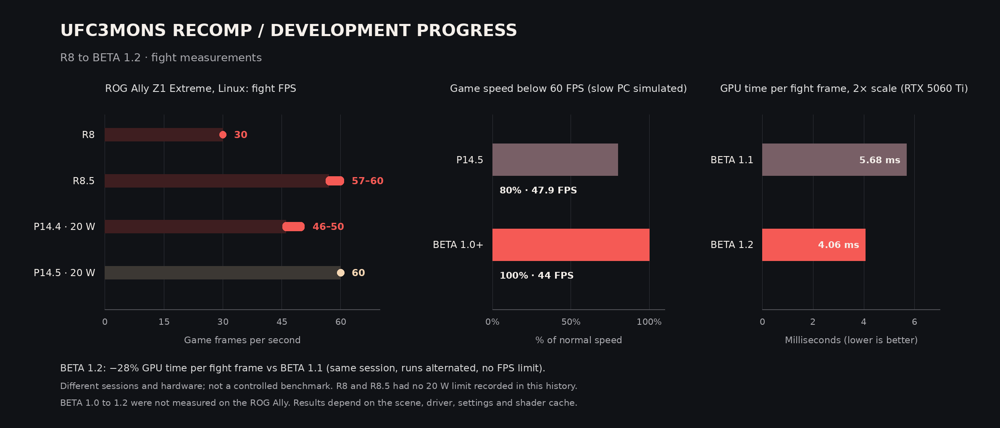

# UFC UNDISPUTED 3 - UFC3MONS RECOMP

[English](README.md) · **Português (Brasil)** · [Español](README.es.md)

### Projeto nativo experimental para PC com Windows e Linux

> 🎯 **Foco principal: o mod Reborn.** O UFC3MONS é feito primeiro para o mod comunitário **UFC Undisputed Reborn**. O Reborn
> recebe mais testes e mais correções; o jogo Original também é suportado. O crédito do Reborn pertence aos seus criadores.

O **UFC3MONS** é um projeto experimental e não oficial para rodar o UFC Undisputed 3 nativamente no PC, com Windows e Linux. Ele
usa recompilação estática com o ReXGlue, um backend gráfico Vulkan e componentes de compatibilidade derivados do Xenia.

O projeto reúne um launcher de configuração, suporte a controle e teclado, integração com o jogo e melhorias de CPU/GPU. As
configurações do Original e do Reborn são acompanhadas separadamente.

> A **versão 1.9** corrige o fechamento do Reborn em lutas de peso-mosca seguidas, faz as lutas do UFC usarem camisas do UFC e as
> do PRIDE camisas do PRIDE, devolve os acentos aos menus em português do Reborn, corrige a roda de arenas do PRIDE, acrescenta a
> área Informações do sistema com verificação automática do processador e chega em builds PGO. [Leia as notas da 1.9](docs/GITHUB-RELEASE-1.9.md).
> Os arquivos do jogo original não estão incluídos: é preciso ter a sua própria cópia do jogo.

> **As atualizações públicas estão pausadas.** A próxima versão pública será a 1.13, quando estiver concluída, validada e aprovada,
> sem prazo definido. O desenvolvimento continua internamente, com um renderizador Vulkan nativo.

[Ver o código](https://github.com/monscriser/UFC3MONS/tree/main/app) · [Releases](https://github.com/monscriser/UFC3MONS/releases) · [Site do projeto](https://monscriser.github.io/UFC3MONS/) · [Relatar um problema](https://github.com/monscriser/UFC3MONS/issues)

## UFC Undisputed 3 no PC: visão geral

| Recurso | Situação / detalhes |
| --- | --- |
| Windows | Carreira e Exibição do Reborn jogáveis; testado no PC (NVIDIA) e no ROG Ally Z1 Extreme |
| Linux | Luta da Carreira do Reborn travada em 60 FPS no ROG Ally Z1 Extreme a 20 W (Modo Jogo do Steam) |
| Gráficos | Vulkan pelo backend derivado do ReXGlue/Xenia; upscaling AMD FSR 1 opcional |
| Áudio | Narração completa, incluindo os anúncios do Bruce Buffer |
| Controles | Controle e teclado remapeável |
| Edições | Pasta do Reborn, Original (XEX ou pasta) ou ISO, lida diretamente sem extrair |
| DLC | Instalado a partir de uma pasta no launcher; os lutadores de DLC aparecem na própria página de seleção |
| Launcher | Português (Brasil), inglês e espanhol; Adicionar à Steam com artes; Informações do sistema |
| Cheats | Recompensas máximas no treino (modo Auto), recompensa máxima de técnicas (Auto, experimental) e Dinheiro em dobro (Carreira). Todos desligados por padrão |
| Conteúdo do jogo | Necessário à parte; não é distribuído aqui |

## Novidades

```
P7    ── cache de constant buffers · Carreira relatada fluida no Ally
P10   ── lotes de proteção de memória · reuso de descritores · limpeza do launcher
P11   ── camisas para todos os 342 modelos do Reborn
P12   ── camisas variadas (fixas por modelo)
P13   ── correção de memória na entrada dos lutadores · timer de 1 ms no Original
P14   ── novo launcher (PT/EN/ES) · Bruce Buffer corrigido · AMD FSR 1 · envio à GPU em duas threads · cheats
BETA 1.0 ── sem câmera lenta entre 60 e 30 FPS · direct resolve · aba Mods · pré-compilação opcional de shaders · filtragem de texturas
BETA 1.1 ── carregamento direto de texturas · opção de VSync · correção do overlay do RenderDoc no Linux
BETA 1.2 ── −28% de GPU por quadro · sangue corrigido em 2× ou mais · loop de áudio corrigido · camisa/boné do lutador criado no Original
BETA 1.3 ── Original: cópias escalonadas não são mais lidas de volta (3×: ~30 → 59 FPS) · sem queda de FPS em lutas longas
BETA 1.4 ── Linux, Original: fim dos congelamentos de vários segundos nas trocas de cena
BETA 1.5 ── menos CPU por draw (tudo exato, 0 diferenças) · correção de crash do Reborn (tabela de saltos)
BETA 1.6 ── readback de GPU mais seguro para lutadores criados · recompensa Auto experimental para técnicas da Carreira
BETA 1.7 ── entradas e introduções a 60 FPS na velocidade original · lutador criado na seleção em ~1,5 s · aba CAF do Reborn
BETA 1.8 ── lutadores criados sem preto/chuvisco em AMD · apresentação a 60 FPS de verdade · crash da Exibição peso-mosca do Reborn · PGO
1.9      ── lutas de peso-mosca seguidas · título de peso-mosca no card · camisas por organização · acentos e títulos no Reborn em PT-BR · roda de arenas do PRIDE · Informações do sistema
```

P8 e P9 foram builds de investigação. Os registros detalhados, com medições, estão nas [Releases](https://github.com/monscriser/UFC3MONS/releases).

## Desempenho

### BETA 1.2 — tempo de GPU por quadro de luta (GPU de desktop, escala 2×, sem limite de FPS)

```
BETA 1.1   5.68 ms  ████████████████████████████
BETA 1.2   4.06 ms  ████████████████████          −28 %
```

RTX 5060 Ti, a mesma luta repetida, execuções alternadas na mesma sessão. Cada mudança tem um parâmetro para ligar ou desligar nos
testes: veja os [parâmetros da BETA 1.2](docs/PARAMETERS-BETA-1.2.md).

### ROG Ally Z1 Extreme, Linux, 20 W — luta da Carreira do Reborn

| Métrica (mesma luta, Ally a 20 W) | P14.4 | P14.5 |
|---|---:|---:|
| FPS médio | 46–50 | **60** |
| Custo de uma falta de página do write-watch | ~330 µs | **~59 µs** |
| Tempo gasto em faltas de página | ~280 ms por segundo | **61 ms por segundo** |
| Clock da GPU | oscilando entre 800 e 2000 MHz | **~1790 MHz, estável** |

No Linux, cada falta de página do write-watch lia e analisava o arquivo `/proc/self/maps` inteiro; a verificação lenta agora só
roda quando é necessária. O desempenho depende da cena, do hardware, do driver, das configurações e do estado do cache de shaders.
A recompilação estática, sozinha, não garante desempenho maior que um emulador. A versão 1.9 não traz novas otimizações de desempenho.



*Medições de sessões e hardwares diferentes, não um benchmark controlado.*

## Recursos

### Launcher
- Abas: **Início, Configurações, Mods, Cheats, Correções, Registro, Saves, Novidades**.
- Fonte do jogo: **pasta do Reborn, XEX/pasta do Original ou ISO** (a ISO é lida diretamente).
- Instalação de DLC a partir de uma pasta; **Adicionar à Steam** cria um atalho com artes.
- Teclado remapeável; suporte a controle.
- **Informações do sistema** (Configurações): processador, suporte a AVX2 e modo de execução, somente leitura. O processador é verificado antes de o jogo abrir.
- Backup de saves, limpeza do cache de shaders e pastas de registro a um clique. **Gravar registros** fica desligado por padrão.

### Gráficos, tempo e desempenho
- Renderização Vulkan com modificações do SDK feitas para o projeto; upscaling **AMD FSR 1** opcional (desligado por padrão).
- Envio à GPU em duas threads, caches de constantes/descritores, lotes de registradores e de proteção de memória.
- Render targets pequenos em tamanho nativo: sangue e marcas ficam no lugar em 2× ou mais.
- Caminho rápido de faltas de página no Linux; controle de readback no Linux que continua barato em sessões longas (1.9).
- Shaders síncronos e limite de 60 FPS. Contador de FPS no jogo com **F6**. Painel para sair: **F4** ou Back + Start por 3 s.

### Cheats (desligados por padrão, funcionam com o jogo aberto)
- **Recompensas máximas no treino (modo Auto):** o treino AUTO da Carreira dá a melhor nota do treino manual (4 estrelas).
- **Dinheiro em dobro:** os Creds ganhos em cada luta da Carreira contam em dobro, dentro do máximo do próprio jogo.
- **Recompensa máxima ao aprender/melhorar técnicas (Auto, experimental):** busca a nota mais alta nas sessões Auto de técnicas;
  a persistência depois de aceitar o resultado ainda precisa de confirmação em jogo.

### Reborn
- Camisas para todos os **342** modelos de lutadores; as lutas do UFC usam camisas do UFC ou neutras e as do PRIDE, camisas do PRIDE ou neutras (1.9).
- Acentos restaurados nos menus em português (1.9).
- Título de peso-mosca no card antes da luta; títulos de categoria em português no card e no placar quando o jogo está em português (1.9).
- Os arquivos originais do jogo nunca são modificados; cópias compatíveis são criadas na primeira abertura.

## Compatibilidade com o Original e o Reborn

| Configuração | Situação atual do desenvolvimento |
| --- | --- |
| Reborn | Carreira e Exibição jogáveis no Windows e no Linux; lutas de peso-mosca seguidas testadas no PC (1.9) |
| Original | Jogável a partir de XEX/pasta ou ISO. Os lutadores criados (CAF) salvam pele, camisa e boné corretamente |
| Ambos | DLC suportado. Mais testes de jogabilidade, saves, controles e hardware continuam bem-vindos |

## Como começar

### Para jogadores
1. Baixe o zip do Windows ou o AppImage do Linux nas [Releases](https://github.com/monscriser/UFC3MONS/releases).
   - O zip do Windows contém `Launcher-Config.exe`, `UFC3.exe` e `data/`. Cada arquivo tem um `.sha256` para conferência.
2. Abra o launcher e aponte para o **seu próprio** jogo: pasta do Reborn, XEX/pasta do Original ou ISO.
3. Opcional: instale DLC a partir de uma pasta, escolha resolução/FSR 1 e idioma, ou use **Adicionar à Steam**.
4. Aperte **JOGAR**.

**Requisitos:** placa de vídeo com Vulkan e processador x86-64 com SSSE3 e SSE4.1 (SSE4.2 no Reborn para Windows). **AVX2 não é
necessário.** Se faltar alguma instrução necessária ao processador, o launcher avisa antes de o jogo abrir.

O botão **Download ZIP** do GitHub baixa o código-fonte, não um jogo jogável. Nenhum dado do jogo, DLC ou save está incluído.

### Para desenvolvedores
1. Leia [dependências e limitações de build](docs/DEPENDENCIAS.md).
2. Use `app/common/` para os códigos atuais do launcher e da integração. Consulte `app/variants/` para os retratos históricos.
3. Revise `sdk-modified/` e as mudanças incrementais em `patches/`.
4. Trate `scripts/historical/` como registros do ambiente original, não como comandos de build portáveis.

Um build limpo ainda exige um SDK compatível, código gerado a partir da sua própria cópia do jogo e outras dependências locais.

## Estrutura do repositório

| Caminho | Conteúdo |
| --- | --- |
| `app/common/` | Códigos compartilhados da integração e do launcher |
| `app/variants/` | Arquivos de integração por plataforma e edição |
| `app/fixes/` | Correções de entrada/apresentação e amostradores de diagnóstico opcionais |
| `sdk-modified/` | Modificações de GPU/runtime, headers de apoio e o shader de readback |
| `patches/` | Mudanças incrementais em relação a retratos locais anteriores |
| `scripts/` | Scripts de patch, build, empacotamento e medição (caminhos locais) |
| `docs/` | Estado do desenvolvimento, dependências, notas de versão e informações de publicação |
| `LICENSES/` | Licença de terceiros incluída |
| `index.html` | Página independente do projeto para o GitHub Pages |

## Limitações conhecidas

- Abaixo de 30 FPS a ação ainda fica mais lenta (entre 60 e 30 FPS a velocidade fica normal desde a BETA 1.0).
- As maiúsculas acentuadas da fonte dos menus do Reborn ficam um pouco mais baixas que as demais.
- Alguns menus, vídeos (Bink) e telas de carregamento rodam a 30 FPS ou caem por instantes.
- O FPS em luta no Steam Deck não foi medido na 1.9.
- Overlays externos podem mostrar a taxa de quadros do compositor; o F6 mostra o contador do próprio jogo.
- As receitas históricas reaproveitam objetos locais e headers pré-compilados. Builds portáveis e reproduzíveis ainda estão pendentes.
- O código gerado do jogo e `ufc_offline_memory.h` ficam fora do código-fonte de propósito.

## Relatar problemas e contribuir

Abra uma [issue](https://github.com/monscriser/UFC3MONS/issues) com a versão (por exemplo, 1.9), a edição Original/Reborn, o
sistema operacional, CPU, GPU, driver, cena, modo de jogo, passos para reproduzir, configurações de tela e os registros relevantes.
Para obter registros, ligue **Gravar registros** em **Registro**, jogue e use **Abrir todos os registros**. Capturas de tela ajudam,
desde que sem informações pessoais.

Não envie arquivos do jogo, DLC, código gerado do jogo ou saves pessoais em issues públicas.

## Créditos e licenças

Agradecimentos aos desenvolvedores e colaboradores do **ReXGlue**, **Xenia**, **Dear ImGui**, **RenderDoc**, **AMD FidelityFX
(FSR 1)** e das comunidades de gráficos e recompilação. Trabalhos anteriores de desempenho do HydroThunderPORT inspiraram
otimizações adaptadas para este projeto.

Algumas correções da BETA 1.7 partiram de ideias encontradas no [UFC3ReX](https://github.com/360recomper/UFC3ReX), de 360recomper:
o travamento da prévia 3D do lutador criado, o locutor esperando o Start, o salvamento das respostas da primeira abertura, o crash ao
carregar Liddell × Quarry no PRIDE e a opção de iluminação estável da pele. Estudamos como eles explicaram cada problema e escrevemos
a nossa própria implementação; nenhum código do UFC3ReX está incluído neste repositório.

O código próprio usa a licença [MIT](LICENSE). Os arquivos derivados do ReXGlue/Xenia mantêm a licença BSD; o header do RenderDoc
mantém o aviso MIT. Veja os [avisos de terceiros](THIRD_PARTY_NOTICES.md) e [LICENSES](LICENSES/).

O UFC3MONS é um projeto comunitário não oficial, sem vínculo nem endosso dos desenvolvedores, editoras ou donos das marcas do jogo
original. Os nomes, artes e conteúdos do UFC Undisputed 3 pertencem aos seus respectivos titulares. Este repositório não concede
nenhuma licença sobre esses materiais.
