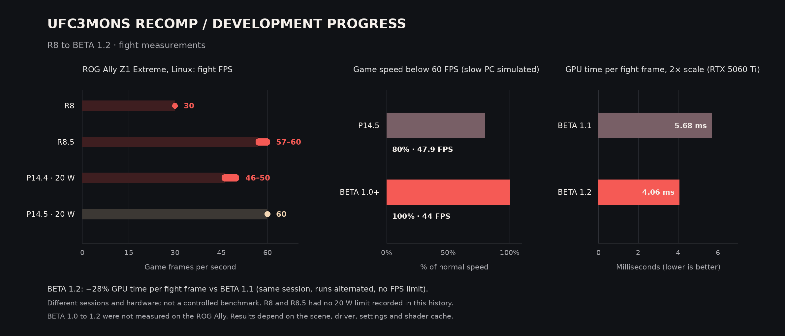

# 🥊 UFC Undisputed 3: Recompiled — BETA 1.6

> **Safer GPU readback for created fighters.** When UFC Undisputed 3 builds a custom fighter's appearance, some Xbox 360 shaders write directly to game memory. BETA 1.6 updates how the Vulkan renderer brings those writes back to the game. It also adds an experimental Auto reward option for learning and improving techniques in Career.

*The chart shows development through BETA 1.5. BETA 1.6 has no new FPS measurements to add to it yet.*

---

## 🎨 Visual effects and the Vulkan renderer

BETA 1.5 cut repeated work on the GPU command thread by reusing render-target setup, samplers, shader translations and pipeline descriptions. BETA 1.6 focuses on the data that travels back from the GPU while the game builds a fighter's appearance.

| Area | What changed in BETA 1.6 |
|:--|:--|
| 👤 **Created fighter appearance** | The renderer validates the game's memory ranges before copying back Xbox 360 shader output. This makes the path used to generate custom fighter skin data safer. |
| 🧩 **GPU and CPU writes** | Readback compares 32-bit words against a snapshot taken before the draw. It copies back only words the shader changed, preserving CPU writes to the other words. |
| ♻️ **Readback buffers** | Requests up to **16 MiB** reuse the Vulkan staging buffer, CPU snapshots and memory-range storage. Larger requests use temporary storage. The readback remains synchronous so the game sees completed shader output. |

The visual features from earlier builds are still here, including the high-resolution blood and floor decal fix, the Original edition's created-fighter skin, shirt and hat fixes, and optional **AMD FSR 1** upscaling. The changes in 1.6 are in how the renderer handles fighter appearance data. The time it takes for a created fighter to appear in **Exhibition** still needs a separate measurement.

---

## 🥋 Career and Camp Sessions

The launcher has a separate experimental option under **Cheats → Maximum reward for learning/improving techniques (Auto)**. It is **off by default**.

| Session | Reward behavior |
|:--|:--|
| **Auto technique session with the option enabled** | The hook is designed to set **1,000 points** and the top grade before the game calculates move XP and level. |
| **Manual technique session** | Rewards follow the session result earned by the player. |
| **Regular Auto training** | The existing **Full Training Rewards (Auto Mode)** setting controls regular training separately. |

## ✅ How it was checked

- **Linux reference build** — The WFA 10 Career fight between Lyoto Machida and Tyson Sweeney was completed on the reference AppImage.
- **Windows and Linux candidates** — Original and Reborn executables were built for both platforms. The packaged executables were checked against the build outputs using SHA-256.
- **Windows Original** — The candidate reached the title screen with logging enabled using a test copy. Confirming the Auto result on screen, checking that the XP remains after accepting it, and playing the final Linux candidate are still pending.

---

## 📦 Build files

| File | Platform |
|:--|:--|
| `UFC3MONS-BETA1.6-Windows.zip` | Windows. Open `UFC3.exe` to launch or `Launcher-Config.exe` for settings. |
| `UFC3MONS-BETA1.6-Linux-x86_64.AppImage` | Linux x86-64. |
| `*.sha256` | SHA-256 checksums for the packages. |

Both packages support **Original** and **Reborn**. You'll need your own copy of UFC Undisputed 3.

Thank you for supporting UFC3MONS.[^community]

[^community]: After BETA 1.5, I thought I might be done for the year. Your positive comments motivated me to come back and work on UFC3MONS again this year. Thank you for the encouragement.
