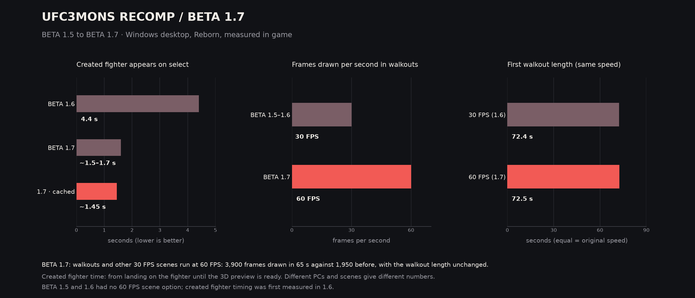

# 🥊 UFC Undisputed 3: Recompiled — BETA 1.7

> **Every 30 FPS scene now runs at 60 FPS.** UFC Undisputed 3 drops walkouts, intros and other presentation scenes to 30 FPS. BETA 1.7 keeps them at 60 FPS at their original speed. Created fighters also show up on fighter select much sooner, Reborn gets its CAF tab back, and the announcer no longer stalls before the fight.

*Measured in game on a Windows desktop with Reborn. Results depend on the PC, the scene and the settings.*

---

## 🎬 60 FPS scenes at the original speed

| Area | What changed in BETA 1.7 |
|:--|:--|
| 🚶 **Walkouts** | Walkouts were the hard case. Their scene sequence advances a fixed step per frame, so at 60 FPS the first walkout finished in 46.5 s instead of 72.4 s. BETA 1.7 halves that step at 60 FPS and keeps the scene timers on the same scale. The first walkout now takes 72.5 s at 60 FPS. |
| 🎥 **Intros and presentation scenes** | They stay at 60 FPS. Their measured lengths match the 30 FPS game. |
| 🖼️ **Real frames** | During a walkout the game draws 3,900 frames in 65 s, against 1,950 at 30 FPS. Each frame is a new render, not a repeated one. |
| ⚙️ **Slower PCs** | When a PC can't hold 60 FPS, the existing adaptive step keeps the game speed tied to real time. |

The setting is on by default (`ufc_cutscene_60`). Replays after a knockout and at the end of a round were not reached in testing.

## 👤 Created fighters

| Area | What changed in BETA 1.7 |
|:--|:--|
| ⏱️ **Fighter select** | A created fighter's 3D preview appears in about **1.5 s** instead of **4.4 s**, without FPS drops. The game's GPU compression of the fighter's textures now runs right away, and the loading work is spread over frames with a small time budget. |
| 💾 **Texture cache** | Created fighter textures are kept in the `cache` folder, so the second time the fighter loads even faster (about 1.45 s). |
| 🧊 **Frozen preview** | Scrolling quickly past a created fighter no longer leaves the 3D preview stuck. |

## 🔁 Reborn

| Area | What changed in BETA 1.7 |
|:--|:--|
| 🗂️ **CAF tab** | Created fighters are back on Reborn's fighter select. The triggers cycle UFC → PRIDE → Random → CAF, and the CAF tab lists only created fighters. The footer shows the new order. |
| 📰 **Career magazine cover** | Some players saw corrupted blocks on the cover after a Career win. While that screen is open, BETA 1.7 now reads GPU results back to the game, which addresses the likely cause. The corruption is rare and couldn't be reproduced in testing. |

The thumbnail of a created fighter in Reborn's grid still shows a grey silhouette. Reborn's grid reads its portraits from its own face pack, which has no pictures of created fighters.

## 🛠️ Fixes

| Fix | Default |
|:--|:--|
| **Announcer no longer waits for Start.** When a fighter has no recorded line, or a line is very short, the introduction used to wait until Start was pressed. Now the fight starts as soon as the introduction ends. | On |
| **First-start answers are saved**, so the questions don't come back on the next start. | On |
| **PRIDE: Liddell vs Quarry no longer crashes while loading.** The position list is checked before the game reads it. | On |
| **Same skin lighting on every camera.** On the ground and in the clinch the game makes the skin darker and warmer. This keeps the stand-up lighting. It's in the new **Fixes** tab. | Off |
| **GitHub #22, a crash after a Career win** (Original), was fixed in BETA 1.6. The GPU writes back created-fighter data only inside valid game memory. | On |

## 🖥️ Launcher and performance

| Area | What changed in BETA 1.7 |
|:--|:--|
| 🎨 **New look** | Sidebar with Home, Settings, Mods, Cheats, Fixes, Logs, Saves and What's new. The **What's new** tab lists the changes in each version. |
| 🔒 **Defaults** | Logs and every cheat start off. |

## ✅ How it was checked

- **Walkouts at 60 FPS** — the same Reborn exhibition flow was run three times with the fix and compared with 30 FPS runs. The first walkout took 72.5–72.9 s at 60 FPS and 72.4–73.0 s at 30 FPS. The functions involved are identical in the Original edition, which was built but not played.
- **Created fighters** — the time from landing on the fighter to the ready preview was logged on Windows, Original and Reborn.
- **Reborn CAF tab** — both trigger directions were checked, and a created fighter was confirmed through to the fight.
- **CPU** — a change to how the video plugin watches GPU memory was measured during the walkout, three runs each, alternated. The game used 896 ms of CPU time per second with the BETA 1.6 plugin and 929 ms/s with the change (+3.6%), so it was left out. BETA 1.7 ships the BETA 1.6 video plugin.
- **All four builds** (Windows and Linux, Original and Reborn) compile and link. The Linux AppImage was built but not played.

## 📦 Build files

| File | Platform |
|:--|:--|
| `UFC3MONS-BETA1.7-Windows.zip` | Windows. Open `UFC3.exe` to launch or `Launcher-Config.exe` for settings. |
| `UFC3MONS-BETA1.7-Linux-x86_64.AppImage` | Linux x86-64. |
| `*.sha256` | SHA-256 checksums for the packages. |

Both packages support **Original** and **Reborn**. You'll need your own copy of UFC Undisputed 3.

## 🙏 Credits

Some BETA 1.7 fixes started from ideas in [UFC3ReX](https://github.com/360recomper/UFC3ReX) by 360recomper: the frozen created-fighter preview, the announcer waiting for Start, saving the first-start answers, the Liddell vs Quarry crash and the steady skin lighting. We read how each problem was explained, then wrote our own implementation. No UFC3ReX code is included in UFC3MONS. Their notes also confirmed that the walkout speed at 60 FPS was still an open problem, which BETA 1.7 solves.

Thank you for supporting UFC3MONS.
